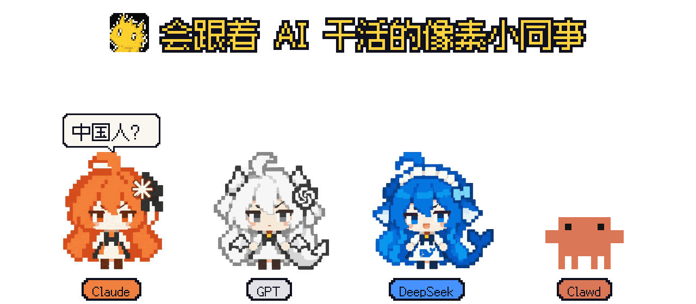
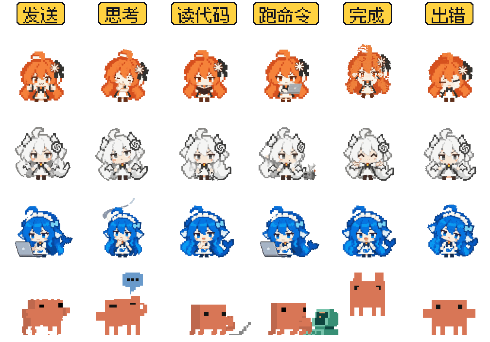
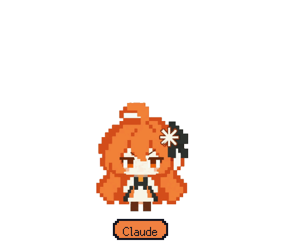
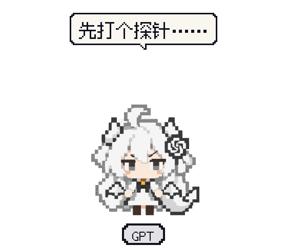
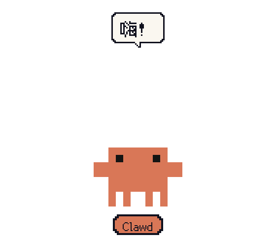
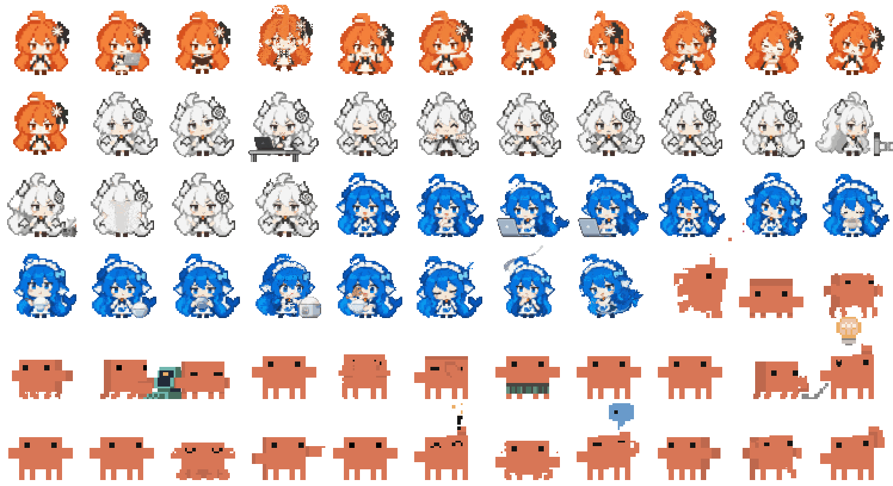

<p align="center">
  <a href="https://plbbl.github.io/pixel-agent-pets/?quality=auto&amp;size=240#theater"></a>
</p>

<p align="center">
  <b>Claude Desktop 里的 Clawd 会跟着 Claude 干活。</b><br>
  现在 Codex、DeepSeek Harness 和你的桌面也有了——还多了三位同事。
</p>

<p align="center">
  <a href="https://github.com/plbbl/pixel-agent-pets/releases/latest"></a>
  <a href="LICENSE"></a>
</p>

<p align="center">
  <a href="#安装">安装</a> · <a href="#跟着干活">跟着干活</a> · <a href="#四位同事">四位同事</a> · <a href="#全部-66-套动作">66 套动作</a> · <a href="docs/README.en.md">English</a>
</p>

## 安装

**一行命令**（macOS / Linux）。自动识别本机的 Codex 和 DeepSeek Harness；Mac 上两个都没有，就装桌面版：

```sh
curl -fsSL https://raw.githubusercontent.com/plbbl/pixel-agent-pets/main/install.sh | bash
```

**或者直接下载桌面版**，自动跟随 Codex / DSH：

<p>
  <a href="https://github.com/plbbl/pixel-agent-pets/releases/latest/download/Pixel-Agent-Pets-macOS-arm64.dmg"></a>&nbsp;
  <a href="https://github.com/plbbl/pixel-agent-pets/releases/latest/download/Pixel-Agent-Pets-macOS-x64.dmg"></a>&nbsp;
  <a href="https://github.com/plbbl/pixel-agent-pets/releases/latest/download/Pixel-Agent-Pets-Windows-x64-setup.exe"></a>
</p>

**或者交给你的 agent**，把这句话发给 Codex / Claude Code / DSH：

```text
帮我装上 https://github.com/plbbl/pixel-agent-pets 的像素宠物
```

<details>
<summary>给 agent：参数与卸载</summary>

```sh
curl -fsSL https://raw.githubusercontent.com/plbbl/pixel-agent-pets/main/install.sh | bash -s -- --codex      # 只装 Codex
curl -fsSL https://raw.githubusercontent.com/plbbl/pixel-agent-pets/main/install.sh | bash -s -- --dsh        # 只装 DSH；多个网页 profile 加 --profile NAME
curl -fsSL https://raw.githubusercontent.com/plbbl/pixel-agent-pets/main/install.sh | bash -s -- --desktop    # macOS 桌面版，装好即启动
curl -fsSL https://raw.githubusercontent.com/plbbl/pixel-agent-pets/main/install.sh | bash -s -- doctor --codex
curl -fsSL https://raw.githubusercontent.com/plbbl/pixel-agent-pets/main/install.sh | bash -s -- uninstall --codex   # 或 --dsh / --desktop
```

装完：Codex 在 `设置 → Mini 与虚拟宠物` 里选角色；DSH 重新打开网页窗口，右键宠物换角色。[完整说明](docs/installation.md)

</details>

## 跟着干活

<p align="center"></p>

AI 在后台干活，你看一眼就知道它在想、在读、在跑命令，还是已经干完了。桌面版和 DSH 跟随真实任务状态；Codex 版走官方宠物的 9 种状态。

## 四位同事

<p align="center">
  
  
  
  
</p>

闲下来它们会自己演。摸一下、拖一下、放着不管，都有反应。

## 全部 66 套动作

<p align="center"><a href="https://plbbl.github.io/pixel-agent-pets/?quality=auto&amp;size=240#theater"></a></p>

<p align="center"><a href="https://plbbl.github.io/pixel-agent-pets/?quality=auto&amp;size=240#theater"><b>在线看高清 320px →</b></a></p>

## 三个版本

| | 桌面版 | DeepSeek Harness | Codex |
|---|---|---|---|
| 动作 | 66 套 + 剧情 | 66 套 + 剧情 | 官方 9 种状态 |
| 跟随 | Codex · DSH | DSH 网页版 | Codex |
| 系统 | macOS · Windows | macOS · Linux | macOS |

<details>
<summary>从源码构建</summary>

```sh
git clone https://github.com/plbbl/pixel-agent-pets.git && cd pixel-agent-pets
npm ci && npm run build && npm test
```

桌面版见 [desktop/](desktop/README.md)；README 动图由 `npm run build:media`（Python 3 + Pillow + NumPy）从原始动作图集生成。

</details>

<p align="center"><sub>抱抱龙出品 · 代码 MIT · 角色美术与 Clawd 见 <a href="NOTICE.md">NOTICE</a></sub></p>
