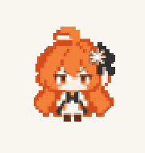
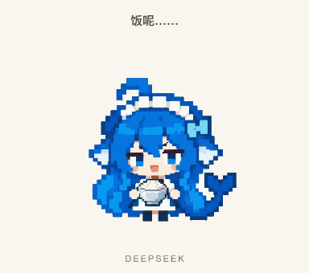
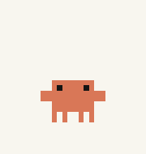

<p align="center">
  
</p>
<h1 align="center">抱抱龙 · Pixel Agent Pets</h1>
<p align="center">四个像素小同事，66 套动作。给桌面添一点小脾气。</p>

<p align="center">
  <a href="https://plbbl.github.io/pixel-agent-pets/?quality=auto&amp;size=240#theater"></a>
</p>

<p align="center">
  <a href="https://plbbl.github.io/pixel-agent-pets/?quality=auto&amp;size=240#theater"><strong>看高清完整动作 ↗</strong></a> ·
  <a href="#安装">安装到桌面</a> ·
  <a href="docs/README.en.md">English</a>
</p>
<p align="center">
  <a href="https://github.com/plbbl/pixel-agent-pets/actions/workflows/test.yml"></a>
  <a href="https://github.com/plbbl/pixel-agent-pets/releases"></a>
  <a href="LICENSE"></a>
</p>

### 先挑清晰度，再看看它们

**[自动清晰度](https://plbbl.github.io/pixel-agent-pets/?quality=auto&size=240#theater)** · **[原画 720p](https://plbbl.github.io/pixel-agent-pets/?quality=720&size=240#theater)** · **[清晰 360p](https://plbbl.github.io/pixel-agent-pets/?quality=360&size=240#theater)** · **[轻量像素](https://plbbl.github.io/pixel-agent-pets/?quality=pixel&size=120#theater)**

展示页默认根据显示大小与屏幕像素密度自动选择清晰度，也可以分别手动调整**清晰度**与**显示大小**，挑选动作、暂停、拖动进度、重播。720p 与 360p 使用保存的清晰视频素材；轻量模式使用桌面宠物图集。Clawd 保持原版像素。GitHub README 不运行交互脚本，上面的入口会直接打开对应清晰度的展示页，进去后仍可随时切换。

<table>
<tr>
<td align="center" width="25%"><a href="https://plbbl.github.io/pixel-agent-pets/?quality=720&amp;size=240#theater"></a><br><strong>Claude</strong><br><sub>认真，但有一点怀疑。</sub><br><sub>12 套动作 · 中文彩蛋</sub></td>
<td align="center" width="25%"><br><strong>GPT</strong><br><sub>可以开始了。先确认一下。</sub><br><sub>14 套动作 · 探针与门禁</sub></td>
<td align="center" width="25%"><br><strong>DeepSeek</strong><br><sub>雷霆思考，光速开饭。</sub><br><sub>15 套动作 · 大米饭宇宙</sub></td>
<td align="center" width="25%"><br><strong>Clawd</strong><br><sub>那个熟悉的小家伙。</sub><br><sub>25 套原版动作</sub></td>
</tr>
</table>

上面的动图是轻量像素预览。清晰版在[动作展示页](https://plbbl.github.io/pixel-agent-pets/?quality=720&size=240#theater)中按需加载，不增加桌面插件的资源开销。

## 安装

### Codex：使用原来的宠物位置

```sh
git clone https://github.com/plbbl/pixel-agent-pets.git
cd pixel-agent-pets
npm ci
node scripts/cli.mjs install --codex
```

`⌘,` → **Mini 与虚拟宠物** → 列表旁圆形刷新箭头 → 选中角色。也可以从[展示页的原生安装入口](https://plbbl.github.io/pixel-agent-pets/#install)添加。

这会安装四套**原生兼容图集**，由 Codex 原来的宠物窗口播放。Claude、GPT、DeepSeek 使用真实高清源，Clawd 保留原像素；在「Mini 与虚拟宠物 → 外观」可调整原生大小（80–224px）。添加 `--quality-choices` 可以同时安装三套 80px 像素选项。

当前官方渲染器仍只接收 9 种固定状态，帧数与节奏由应用决定，因此这个安装入口**尚不能播放完整动作库或剧情字幕**。仓库另有共享完整播放器与展示层接入提案，尚未安装进官方应用。不会把精简图集或额外窗口描述成原位完整支持。

### 官方 DeepSeek Harness：完整动作

先安装并启动过[官方 DSH](https://github.com/deepseek-ai/deepseek-harness)，再在克隆的仓库中运行：

```sh
npm ci
node scripts/cli.mjs install --dsh --profile web
```

重开对应 DSH profile。**右键宠物切换角色、大小和清晰度**，保留完整动作与上方短字幕。自动清晰度随显示大小和屏幕精度选择 80/160/320px 源；调整时继续当前动作。已实测官方 **0.1.0-rc.6 web 客户端**；终端 TUI 不显示这个网页插件。桌面包装器需要指定它实际使用、且已存在的 profile。

<details>
<summary><b>可选：独立 macOS 完整动作伴侣</b></summary>

另有独立 App 可播放完整动作，**它会额外创建悬浮窗口，不属于 Codex 原位方案**。如果你只接受 Codex 原来的宠物位置，请使用上面的原生兼容版。

在 [Releases](https://github.com/plbbl/pixel-agent-pets/releases/latest) 下载 **Pixel-Agent-Pets-macOS.zip**，解压并打开 **Pixel Agent Pets.app**。macOS 13+，支持 Apple Silicon 与 Intel。右键切换角色、预览完整动作；左键拖动位置。菜单栏爪印可重新显示或退出。

预编译 App 无需 Node.js、API Key、辅助功能或录屏权限。开源构建使用本地签名，尚未经过 Apple 公证；系统确认由你在 macOS 中完成。

从源码构建需要 Node.js 20+ 与 Xcode Command Line Tools：

```sh
node scripts/cli.mjs install --codex-full
```

打开 `~/Applications/Pixel Agent Pets.app`。源码构建只签名本项目自己的 App，不修改 Codex。

</details>

### 工作状态与本地数据

| | Codex 原位兼容版 | DSH 插件 | 可选独立伴侣 |
|---|---|---|---|
| 位置 | Codex 原宠物窗口 | DSH 输入区 | 额外悬浮窗口 |
| 动作 | 9 行固定图集 | 66 套完整动作 | 66 套完整动作 |
| 触发 | 官方原生状态机 | 官方 UI 状态 | 本地活动事件 |
| 剧情与字幕 | 当前不支持 | 支持 | 支持 |
| 角色切换 | 官方设置 | 右键 | 右键 / 菜单栏 |

固定脚底线、解码后切画、有限图片缓存。静止时不重复画，隐藏时停表；尊重系统“减少动态效果”。不改模型内核，不把字幕写进提示词，不为动画发起模型请求。

可选独立伴侣在本机增量读取 `CODEX_HOME/sessions` 的活动记录，提取事件类型、工具名、运行状态；提示词只计算“是否含中文”。原文不保存、不上传，不扫描整个历史。这个文件格式不是稳定的官方 API，遇到不认识的事件会忽略。原生图集与 DSH 插件不需要这个读取步骤。

Claude 的中文剧情只是本地角色表演：不识别国籍，也不会封禁任何账户。详见[行为说明](docs/behavior.md)。

### 开发与卸载

```sh
npm run build                   # DSH 与原生兼容图集
npm run build:site              # 展示页
npm run build:desktop           # 可选独立 App
npm run check
npm test

node scripts/cli.mjs uninstall --codex
node scripts/cli.mjs uninstall --dsh --profile web
node scripts/cli.mjs uninstall --codex-full
```

卸载前先退出独立 App。安装器只处理本项目拥有的文件，保留可恢复备份，不覆盖其他宠物、插件、授权策略或 API Key。[详细安装说明](docs/installation.md)

---

<p align="center"><sub>抱抱龙出品。小小像素，认真陪伴。<br>独立同人项目。代码使用 MIT；抱抱龙标志、原版 Clawd、第三方图形与商标不在代码授权内，见 <a href="NOTICE.md">作品与来源说明</a>。</sub></p>
