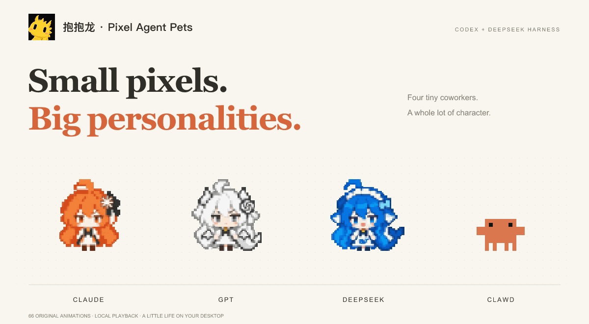

# Pixel Agent Pets



**Four tiny coworkers. A whole lot of character.**

Claude, white GPT, DeepSeek, and original Clawd — 66 full animations for Codex desktop and official DeepSeek Harness.

[Interactive theater](https://plbbl.github.io/pixel-agent-pets/) · [Download](https://github.com/plbbl/pixel-agent-pets/releases/latest) · [中文](../README.md)

## Codex: full-animation companion

Download **Pixel-Agent-Pets-macOS.zip** from Releases, extract it, and open **Pixel Agent Pets.app**. Supports macOS 13+, Apple Silicon and Intel. No Node.js or API key required for the prebuilt app.

The companion is a small native transparent window. Right-click to switch characters or preview every complete animation; drag to reposition. It reads local Codex activity records incrementally to follow thinking, tools, waiting, completion and interruption. It does not patch Codex or replace its built-in pet renderer. Hide the built-in pet separately if you want only one companion visible.

No Accessibility or Screen Recording permission is required. Builds are locally signed and not Apple-notarized; handle any macOS confirmation yourself or build from source:

```sh
git clone https://github.com/plbbl/pixel-agent-pets.git
cd pixel-agent-pets
npm ci
node scripts/cli.mjs install --codex-full
```

Source builds require Node.js 20+ and Xcode Command Line Tools. Open `~/Applications/Pixel Agent Pets.app` after installation.

## Official DeepSeek Harness

```sh
npm ci
node scripts/cli.mjs install --dsh --profile web
```

Restart that profile. Right-click to switch pets. Verified with official DSH 0.1.0-rc.6 web; terminal TUI is not supported by the UI plugin.

## Native Codex compatibility sheets

`node scripts/cli.mjs install --codex` installs four compact native sheets. Select them under Settings → Mini & Pets. The official renderer has a fixed grid and cannot play this complete animation library; choose the full companion for original frames and captions.

## Local data

The full companion incrementally reads `CODEX_HOME/sessions`, retains only activity facts, and reduces prompt text to a boolean indicating CJK characters. No conversation text is stored or uploaded. The transcript format is not an official stable API, so unknown records are ignored. DSH and native compatibility sheets do not use this reader.

Code is MIT. Original Clawd, third-party artwork and trademarks are excluded; see [NOTICE](../NOTICE.md).
