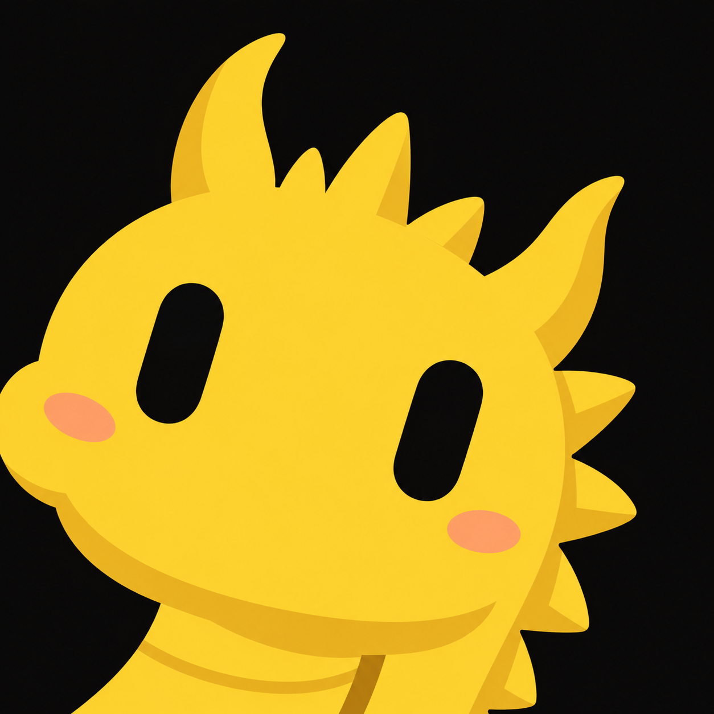
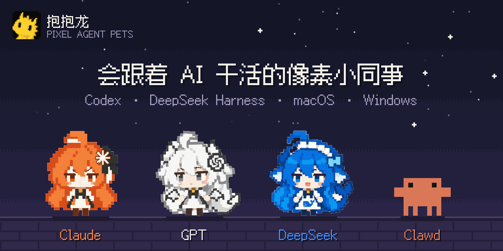

# 抱抱龙 · Pixel Agent Pets

<p align="center"></p>

[](https://plbbl.github.io/pixel-agent-pets/?quality=auto&size=240#theater)

**Four tiny coworkers. A whole lot of character.** Claude, white GPT, DeepSeek and original Clawd. The standalone macOS / Windows desktop pet and DSH use all 66 actions. Codex uses official nine-state compatibility sheets.

[Automatic quality](https://plbbl.github.io/pixel-agent-pets/?quality=auto&size=240#theater) · [HD 320px showcase](https://plbbl.github.io/pixel-agent-pets/?quality=720&size=240#theater) · [160px showcase](https://plbbl.github.io/pixel-agent-pets/?quality=360&size=240#theater) · [Lightweight pixels](https://plbbl.github.io/pixel-agent-pets/?quality=pixel&size=120#theater) · [中文](../README.md)

The showcase lets you choose quality and size, pick an action, pause, scrub and replay. It displays the complete source library. That does not mean the Codex compatibility sheets automatically play every full action or story.

## Standalone desktop pet: macOS and Windows

[Download the latest desktop installer](https://github.com/plbbl/pixel-agent-pets/releases/latest). On macOS, open the DMG and drag the app into Applications. On Windows, run the installer. No Node.js, DSH, Codex or API key is required.

A transparent, draggable pet lives on your desktop. Right-click it or use the tray menu to change character, play a complete story or single action, adjust size and quality, hide or quit. By default, it follows real local Codex / DSH work states. The Follow Work menu selects Auto, Codex, DSH or Off. Click to pet, hover for a response, drag and release for landing feedback, and click to wake it from rest. Idle routines use character-specific stories, with real work taking priority. All media stays local; rendering uses the system WebView.

## Codex: official nine-state compatibility

```sh
curl -fsSL https://raw.githubusercontent.com/plbbl/pixel-agent-pets/main/install.sh | bash -s -- --codex
```

Use a Codex desktop version that supports custom pets. The installer adds only official-format pet assets. **It does not modify the application, its signature or the CLI.** Open Settings → Mini & Pets, refresh the list and select a character. Reopen Codex if the list has not updated.

Claude, GPT and DeepSeek each have HD and 80px pixel resource choices; Clawd retains its original pixels. Adjust size through the official Appearance setting (80–224px). The official pet system owns position, selection and task-state playback.

**Codex has nine fixed state mappings.** Thinking, output and tool execution share the native `running` state. Full 66-action triggers, Chinese stories and captions are not part of this compatibility mode.

## Official DSH: all 66 actions and triggers

```sh
curl -fsSL https://raw.githubusercontent.com/plbbl/pixel-agent-pets/main/install.sh | bash -s -- --dsh
```

Install and launch the [official DSH web client](https://github.com/deepseek-ai/deepseek-harness) first. One existing web profile is selected automatically; multiple profiles prompt for a choice. Broken profiles or missing unrelated dependencies stop installation with configuration preserved.

Reopen the selected web window. **Right-click the pet to change character, size or quality**, or preview full actions. Real sending, thinking, output, tools, questions, errors and completion trigger the full library; idle actions rotate. Automatic quality selects 80/160/320px sources using display size and screen density, keeping the current action phase. Verified with official **0.1.0-rc.6 web**; terminal TUI profiles do not display this web plugin.

Both entry points download a verified prebuilt package. No clone, npm dependencies or pet API key is needed. A missing Node runtime is prepared separately without replacing system Node. The Codex and DSH plugins use their existing client UI. The desktop pet is a separately installed application.

## Check or remove

```sh
curl -fsSL https://raw.githubusercontent.com/plbbl/pixel-agent-pets/main/install.sh | bash -s -- doctor --codex
curl -fsSL https://raw.githubusercontent.com/plbbl/pixel-agent-pets/main/install.sh | bash -s -- doctor --dsh

curl -fsSL https://raw.githubusercontent.com/plbbl/pixel-agent-pets/main/install.sh | bash -s -- uninstall --codex
curl -fsSL https://raw.githubusercontent.com/plbbl/pixel-agent-pets/main/install.sh | bash -s -- uninstall --dsh
```

Codex removal moves only project-managed pet files into a recovery backup; no app restore or re-signing is needed. DSH removal affects only this plugin. Other pets, plugins, sessions, permissions and model settings remain intact. See [installation details](installation.md).

## Local behavior

The standalone pet and DSH use fixed foot alignment, decoded-image handoff and bounded caches. Hidden players pause and reduced motion is respected. Animation never requests a model or adds captions to prompts. Current Chinese draft detection produces only a local boolean. Codex compatibility sheets do not observe drafts or scan session files.

The standalone pet reads bounded Codex status events and DSH public event facts. It does not retain transcript text, tool arguments, command output or credentials. New Chinese input produces only a local boolean. An existing DSH backend must be restarted normally after its current work finishes to load the updated plugin; refreshing the page alone does not reload server code.

Claude's Chinese-language sequence is a local performance in the standalone pet, DSH and the full showcase. It does not determine nationality or ban an account.

<details>
<summary><b>Source development</b></summary>

Development uses `git clone`, `npm ci`, `npm run build`, `npm run check` and `npm test`. These dependencies are unnecessary for one-command installation. The optional [individual Codex import links](https://plbbl.github.io/pixel-agent-pets/#native-install) are also nine-state compatibility assets, without full story triggers.

</details>

Code is MIT. The Baobaolong logo, original Clawd, third-party artwork and trademarks are excluded; see [NOTICE](../NOTICE.md).
